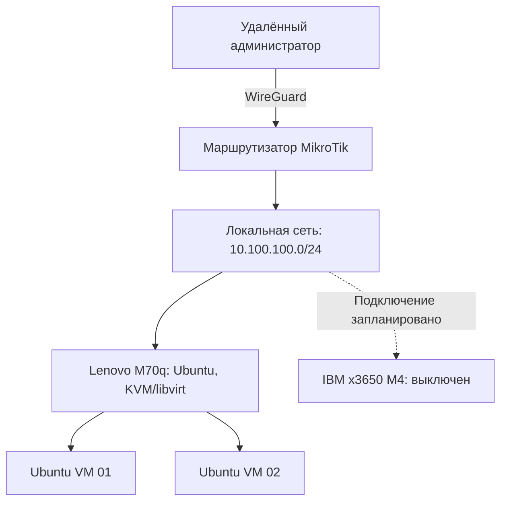

# Linux Infrastructure LAB

Личная инфраструктурная лаборатория для практического изучения администрирования Linux, виртуализации, сетей и автоматизации. Проект строится на физическом оборудовании и виртуальных машинах с ориентацией на воспроизводимые инженерные решения.

> **Статус проекта:** начальная стадия. Реализованные компоненты отделены от планируемых. Лаборатория не является промышленной инфраструктурой или коммерческим проектом.

## Цели

- Построить и документировать воспроизводимую инфраструктуру на Linux.
- Освоить безопасное удалённое администрирование, развёртывание сервисов, мониторинг и восстановление.
- Фиксировать инженерные решения, проверку работоспособности и устранение неисправностей.
- Подтверждать навыки работающими конфигурациями, скриптами и результатами тестирования.

## Оборудование и текущее состояние

| Компонент | Оборудование и ПО | Статус |
| --- | --- | --- |
| Основной сервер | IBM System x3650 M4; 2 × Xeon E5-2650L v2; 128 ГБ ОЗУ; 4 × SAS HDD (RAID 10); Ubuntu Server 24.04 LTS | **Выключен** — предстоят перевозка, подключение к сети и подготовка к автономной работе |
| Управляющий и тестовый узел | Lenovo ThinkCentre M70q; Ubuntu Server 24.04 LTS; около 8 ГБ ОЗУ | **Использовался для практики** — установлены KVM/QEMU и libvirt, созданы две учебные VM с Ubuntu Server |
| Сетевой шлюз | MikroTik RouterOS | **Настроен** — локальная маршрутизация и WireGuard |
| Виртуализация | KVM/QEMU, libvirt, QCOW2, VirtIO | **Изучено на практике** на Lenovo |

Указание выполненных ранее настроек не означает, что все устройства доступны по сети в настоящее время.

## Архитектура

Основная локальная сеть — `10.100.100.0/24`, шлюзом выступает MikroTik. WireGuard настроен для удалённого доступа. Отдельные серверные подсети и сети виртуальных машин пока находятся на стадии проектирования.

Схема отражает общую архитектуру и не гарантирует текущую доступность каждого узла. Публичные адреса, учётные данные и секретные ключи намеренно не публикуются.

## План работ

| Этап | Результат | Статус |
| --- | --- | --- |
| 1. Базовая документация | Состав оборудования, архитектура, статусы компонентов и правила безопасности | В работе |
| 2. Удалённо управляемый сервер | Перевозка и подключение IBM, проверка запуска, SSH и возможностей восстановления | Запланировано |
| 3. Эксплуатация Linux | Скрипты проверки состояния, управление службами, тесты резервного копирования и восстановления | Запланировано |
| 4. Прикладные сервисы | Docker Compose, Nginx и PostgreSQL с проверкой развёртывания | Запланировано |
| 5. Автоматизация | Настройка серверов с помощью Ansible | Запланировано |
| 6. Мониторинг и CI | Мониторинг состояния инфраструктуры и базовый процесс CI | Запланировано |

Kubernetes и сложные кластерные решения не входят в первоначальный объём проекта.

## Принципы документации и проверки

Для каждого реализованного компонента по возможности фиксируются:

1. Задача и обоснование выбранного решения.
2. Требования, конфигурации и команды для воспроизведения.
3. Способ проверки и фактический результат.
4. Ограничения, возможные неисправности и способы восстановления.

**Безопасность:** в репозиторий не добавляются пароли, токены, приватные SSH-ключи и ключи WireGuard, необработанные экспорты конфигураций и персональные данные. В примерах используются заглушки и несекретные значения.

## О проекте

В репозитории документируется **самостоятельная лабораторная практика**. Коммерческий опыт системного администрирования не смешивается с результатами домашних экспериментов.
