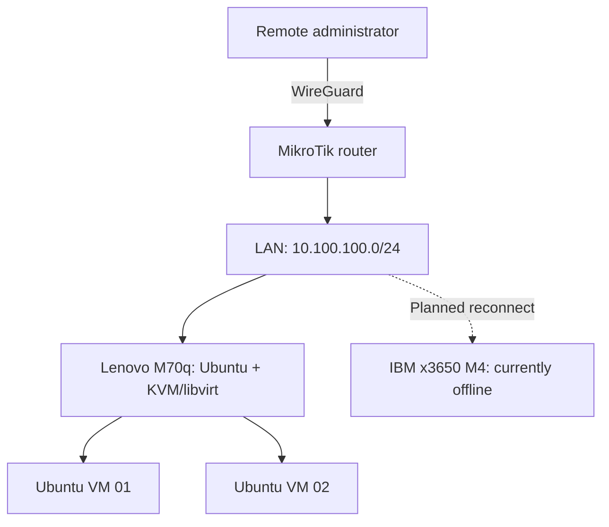

# Linux Infrastructure LAB

A personal, production-inspired infrastructure laboratory for hands-on Linux administration, virtualization, networking, and infrastructure automation.

> **Project status:** Early development. This repository distinguishes verified lab work from planned changes. It is a personal lab, not a production environment or a commercial deployment.

## Objectives

- Build and operate a reproducible Linux infrastructure using physical hardware and virtual machines.
- Practice secure remote administration, networking, deployment, monitoring, and recovery.
- Document configuration decisions, validation procedures, and troubleshooting results.
- Demonstrate practical systems engineering skills through working configurations and testable outcomes.

## Infrastructure inventory

| Component | Hardware / software | Current status |
| --- | --- | --- |
| Primary server | IBM System x3650 M4; 2 × Xeon E5-2650L v2; 128 GB RAM; 4 × SAS HDD (RAID 10); Ubuntu Server 24.04 LTS | **Offline** — relocation, networking, and unattended operation pending |
| Management / test node | Lenovo ThinkCentre M70q; Ubuntu Server 24.04 LTS; ~8 GB RAM | **Lab use** — KVM/QEMU and libvirt installed; two Ubuntu Server test VMs created |
| Network gateway | MikroTik RouterOS | **Configured** — LAN routing and WireGuard remote-access setup |
| Virtualization | KVM/QEMU, libvirt, QCOW2, VirtIO | **Practiced** on the Lenovo node |

Hardware specifications and historical configuration notes describe equipment already used in the lab; they do not imply that every device is currently online or remotely accessible.

## Architecture: current and planned

The existing primary LAN uses `10.100.100.0/24`, with MikroTik acting as the gateway. WireGuard is configured for remote administration. Additional server and VM subnets are **design proposals**, not yet verified as deployed.

The diagram is conceptual and does not assert that all hosts are currently reachable. Public IP addresses, access credentials, and private key material are intentionally excluded.

## Roadmap

| Phase | Deliverable | Status |
| --- | --- | --- |
| 1. Documentation baseline | Inventory, architecture, implementation status, and safety rules | In progress |
| 2. Remote-capable server | Relocate and reconnect IBM; validate startup, SSH access, and recovery options | Planned |
| 3. Linux operations | Reproducible health checks, service administration, and backup/restore tests | Planned |
| 4. Application stack | Docker Compose, Nginx, and PostgreSQL with documented verification | Planned |
| 5. Automation | Ansible-managed configuration | Planned |
| 6. Observability and delivery | Monitoring and a basic CI workflow | Planned |

Kubernetes and complex clustering are intentionally out of scope for the initial portfolio.

## Validation principles

Every implemented feature should include:

1. The problem and engineering decision.
2. Prerequisites and reproducible configuration or commands.
3. A verification procedure and observed result.
4. Limitations, failure scenarios, and recovery notes where applicable.

**Security:** No passwords, API tokens, SSH or WireGuard private keys, unredacted device exports, or personal information will be committed. Examples will use placeholders and non-sensitive values.

## Background

This repository documents **independent laboratory practice**. Professional experience in IT system administration is separate from the work demonstrated here.
